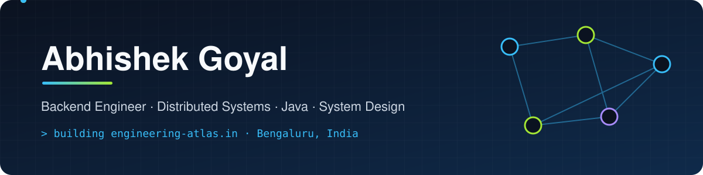
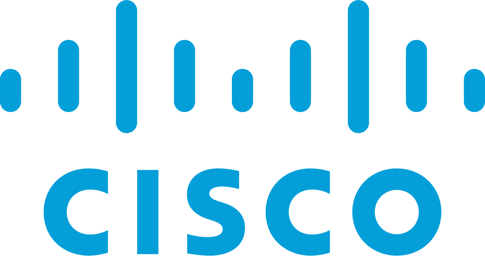

I build backend systems that stay up when the cluster doesn't. Most of my work sits where **Java concurrency**, **distributed coordination** and **data infrastructure** meet.

Right now I'm building [**Engineering Atlas**](https://engineering-atlas.in), a deep, practical learning hub for backend engineers: Java internals, low-level design and system design, written the way you'd explain it to a teammate.

[Engineering Atlas](https://engineering-atlas.in) &nbsp;·&nbsp; [Portfolio](https://abhishekgoyal.tech) &nbsp;·&nbsp; [LinkedIn](https://www.linkedin.com/in/abhishekgoyal17/) &nbsp;·&nbsp; [YouTube](https://www.youtube.com/c/AbhishekGoyal) &nbsp;·&nbsp; [Instagram](https://www.instagram.com/abhishek.tech._/) &nbsp;·&nbsp; [Book a 1:1](https://topmate.io/abhishek_goyal17/)

---

### Work

| | Role | What I did |
|---|---|---|
|  | **SDE II, Oracle**  Dec 2024 – Jul 2026 | Autonomous Health Framework: cluster diagnostics, health monitoring and scheduling across Oracle RAC and Data Guard fleets. Multithreaded Java, distributed coordination, AI-assisted diagnostics. |
|  | **SDE I, Cisco AppDynamics (Splunk)**  Jul 2023 – Nov 2024 | Browser Real User Monitoring: traffic simulation, session sampling at scale and ingestion microservices. Spring Boot, Redis, Kubernetes on AWS, cloud migration. |
|  | **SWE Intern, Red Hat**  Jan 2023 – Jun 2023 | Go tooling that manages build pipeline config through the GitHub API. |

### What I write about

| | |
|---|---|
| **Java internals** | JVM, the memory model, locks, virtual threads, lock-free code |
| **Low-level design** | SOLID, design patterns, machine-coding problems solved end to end |
| **System design** | Case studies from rate limiters to surge pricing, with the trade-offs spelled out |
| **Distributed systems** | Consensus, sagas, idempotency, P2P, service meshes |

Short versions go out as reels on [@abhishek.tech._](https://www.instagram.com/abhishek.tech._/). The long versions live on [engineering-atlas.in](https://engineering-atlas.in).

### Stack

`Java` `Go` `Python` `Spring Boot` `Kafka` `Redis` `PostgreSQL` `Oracle DB` `MongoDB` `Docker` `Kubernetes` `AWS` `GCP` `Linux` `Snowflake` `Databricks`

### Talk to me

I do 1:1 sessions on **resumes, job switches and system design interview prep**. [Book a slot on Topmate →](https://topmate.io/abhishek_goyal17/)

 

<picture>
  <source media="(prefers-color-scheme: dark)" srcset="https://raw.githubusercontent.com/abhishekgoyal17/abhishekgoyal17/output/github-contribution-grid-snake-dark.svg">
  
</picture>

Bengaluru, India
